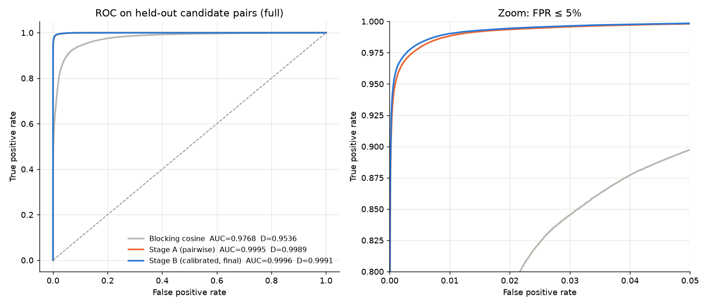
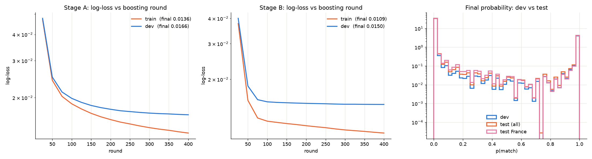

# Business Entity Resolution

Our solution to the **ML Challenge 2026 business entity resolution** task, built by team **Chaicopath**:
Shreeya KS (lead), Sanath Coonani, Pranav Prerepa and Sudhir.

The task: for each of 1.7 million business records in Source 1, find every record in Sources 2 and 3
(10 million between them) that describes the same business. The records are noisy. Names come in
Indian scripts, with typos, shuffled words, `a/k/a` aliases and web handles glued together, house
numbers are mangled, and about a quarter of the pool matches nothing. Scoring is per-entity F0.5,
so a false match costs twice as much as a missed one.

https://github.com/user-attachments/assets/0541e996-ea9a-45cc-a9cf-72948d27b3a7

**Held-out macro F0.5: 0.9720** (ROC AUC 0.9996), on CPU plus a laptop RTX 3050, with no external data,
APIs or pretrained models.

## How it works

```
TSV ─► clean ─► learn synonyms ─► block (top 15 per source) ─► XGBoost × 2 ─► decode for F0.5 ─► submission
```

| Stage | What it does | Why |
|---|---|---|
| **Clean** | Transliterates any script to ASCII, splits `a/k/a` / `dba` aliases, unwraps domains, pulls out house and postal numbers | 23.5% of India names in S2 are not in Latin script |
| **Learn synonyms** | Aligns the words that differ between true training pairs and keeps the substitutions that recur: `praivet→private`, `mharastr→maharashtra`, `st→street`. Splits glued handles: `maabigconsultancy → maa big consultancy` | No hand-written dictionaries; the labels teach the spelling variants |
| **Block** | IDF-weighted sparse search over name, address and number keys, plus *combination* keys (name word × house number, …) | All-pairs would be 1.7 × 10¹³ comparisons. This keeps **97.8%** of true pairs in 15 candidates per source |
| **Stage A** | XGBoost on 44 pairwise similarity features (rapidfuzz, IDF cosines, competition between S1 records) | Scores each candidate pair |
| **Stage B** | XGBoost on the whole candidate list: rank, gaps, and whether the S2 match agrees with the S3 match | A true S2 match and a true S3 match are noisy copies of the same business |
| **Decode** | Gives each S2/S3 record to one S1 only, then picks each S1's list length to maximise *expected* F0.5 | Optimises the actual metric per entity, empty lists included |

What each step bought on the held-out dev set:

| Step | Macro F0.5 |
|---|---|
| Stage A, best fixed threshold | 0.9681 |
| + Stage B, calibrated | 0.9694 |
| + expected-F0.5 decoding | 0.9714 |
| + 800 boosting rounds (submitted) | **0.9720** |

<p>
  
  
</p>

## Running it

The competition data isn't included (it isn't ours to redistribute). Point the pipeline at a folder
holding `train/` and `test/`:

```bash
cd code/business_entity_resolution
python -m venv .venv && . .venv/bin/activate && pip install -r requirements.txt
PYTHON=python bash run_pipeline.sh /path/to/dataset work output
```

It takes about 1.5 hours on 12 cores and an RTX 3050 (XGBoost falls back to CPU without a GPU) and peaks
around 9 GB of RAM. It writes `output/matching_results.tsv` and `output/candidate_pairs.tsv`, then runs
the official validator.

## Repository

| Path | What |
|---|---|
| [`pipeline.md`](pipeline.md) | The full write-up: what the data showed, every stage, every result |
| [`eda_summary.md`](eda_summary.md), `data_vis.ipynb` | Exploratory analysis over the full dataset |
| [`code/business_entity_resolution/`](code/business_entity_resolution/) | The pipeline (`src/`), its README and diagnostics |
| [`submission/…/Documentation_template.md`](submission/Chaicopath_submission/Documentation_template.md) | The methodology document we submitted |
